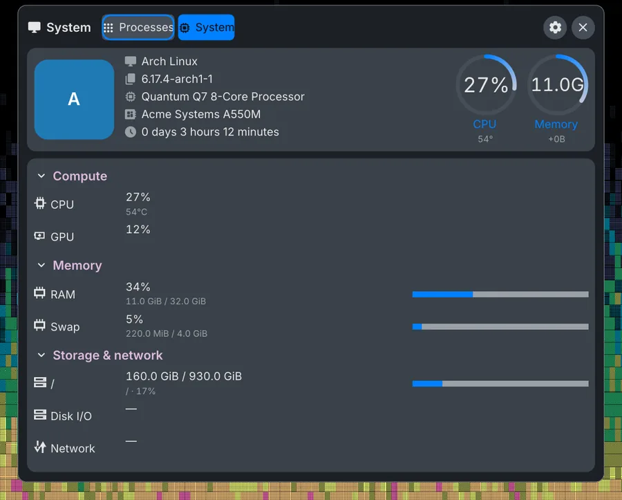

<p align="center">
  
</p>

Read-only system telemetry for Go. Linux collectors read CPU, memory, disks, network, sensors, GPU and processes from `/proc` and `/sys`. FreeBSD provides CPU, load, RAM and swap readings. The library uses the standard library and feeds [sysc-shell](https://github.com/Nomadcxx/sysc-shell) and [sysc-greet](https://github.com/Nomadcxx/sysc-greet).

<p align="center">
  <br>
  <sub>The sysc-shell system monitor, fed by sysc-metrics (fixture data).</sub>
</p>

[Documentation site](https://nomadcxx.github.io/sysc/docs/components/sysc-metrics/) · [Features](#linux-features) · [Usage](#usage) · [Development](#development)

## Linux features

- **CPU**: total and per-core usage, per-core frequency, and load averages
- **Memory**: RAM and swap
- **Disks**: capacity for every mounted filesystem, plus read/write rates and busy time per block device
- **Network**: byte and packet rates per interface, with error and drop counters
- **Temperature**: one CPU package reading, from k10temp, coretemp or a thermal zone, whichever the
  machine has
- **ThinkPad fan**: RPM, driver status and the requested cooling level, from the IBM ACPI interface
- **LEDs**: brightness, ceiling, firmware-change counter and write access for every device in the sysfs
  LED class, which is how the keyboard backlight and the lid logo light are exposed
- **Battery**: charge, state, power draw and time remaining, combined across every battery and UPS
- **GPU**: usage, temperature, name and VRAM for AMD, NVIDIA and Intel
- **Processes**: CPU and memory per process, with identities that don't get confused by PID reuse
- **Uptime**
- **Small**: standard library only, with no background polling

## Installation

**Requires:** Go 1.26+ on Linux or FreeBSD.

```bash
go get github.com/Nomadcxx/sysc-metrics
```

## FreeBSD

`NewCPUSampler` reports total and per-core utilization and load averages. CPU frequency fields remain invalid. `ReadMemory` reports managed RAM, with free and inactive pages counted as available, plus swap usage from `swapinfo`. RAM availability follows FreeBSD page accounting.

The native backend runs `/sbin/sysctl` and `/usr/sbin/swapinfo` with a two-second timeout per command and a fixed C locale. Both tools ship with FreeBSD; collection works without root.

`ReadGPU` and `GPUSampler.Sample` return an error wrapping `errors.ErrUnsupported`. The other readers and samplers remain Linux-only.

## Usage

Values that don't depend on time come from a single read:

```go
mem, err := metrics.ReadMemory()
if err != nil {
	return err
}
fmt.Printf("memory: %d of %d bytes used\n", mem.Memory.UsedBytes, mem.Memory.TotalBytes)
```

`ReadMemory`, `ReadFilesystems`, `ReadThermal`, `ReadFan`, `ReadLEDs`, `ReadBattery`, `ReadUptime` and
`ReadGPU` all work
this way.

Rates need two readings, so CPU, disk, network, process and GPU usage come from a sampler. Call
`Sample` on your own ticker. The first sample only sets a baseline, and its rates come back with
`Valid == false`:

```go
cpu := metrics.NewCPUSampler()
gpu := metrics.NewGPUSampler()
defer gpu.Close()

for range time.Tick(time.Second) {
	c, err := cpu.Sample()
	if err != nil {
		return err
	}
	if c.Usage.Valid {
		fmt.Printf("cpu: %.0f%%\n", c.Usage.Fraction*100)
	}

	g, _ := gpu.Sample()
	for _, card := range g.GPUs {
		if card.Usage.Valid {
			fmt.Printf("%s: %.0f%%\n", card.Name, card.Usage.Fraction*100)
		}
	}
}
```

On a desktop with an RTX 4060 that prints:

```text
memory: 18722406400 of 33559834624 bytes used
AD106 [GeForce RTX 4060]: 6%
cpu: 14%
AD106 [GeForce RTX 4060]: 5%
cpu: 12%
```

A few rules hold everywhere:

- **Check `Valid`.** It separates a real zero from "no reading". An idle GPU at 0% is valid; a GPU
  nobody can measure is not.
- **Snapshots can be partial.** One unreadable mount or sensor doesn't fail the whole read. It shows
  up in the snapshot's `Issues`, and everything else is filled in.
- **A missing battery or sensor is not an error.** `ReadBattery` reports `Present == false` on a
  desktop, and `ReadThermal` reports `Valid == false` where there is no known sensor.
- **One sampler, one caller.** Samplers keep the previous reading and aren't safe for concurrent use.
  Give each polling loop its own. Close a `GPUSampler` when you stop polling, because it holds open
  counters.

How often to poll, what to cache, and how to show the numbers is up to you.

## GPU usage

Each vendor exposes usage differently:

| GPU | Usage | VRAM |
|---|---|---|
| AMD | `gpu_busy_percent` in sysfs | `mem_info_vram_used` / `mem_info_vram_total` |
| NVIDIA | `nvidia-smi`, run only when an NVIDIA card is present | same `nvidia-smi` query |
| Intel | `GPUSampler` only, from the second sample on | not reported |

`ReadGPU` never reports Intel usage. `GPUSampler` gets it from the i915 PMU counters, which need
`CAP_PERFMON` on the process. Without that, it falls back to the per-client DRM counters in
`/proc/*/fdinfo`, which covers i915 and amdgpu. That fallback only sees your own processes, so if the
only GPU clients belong to another user (a greeter, say), usage stays invalid rather than showing a
false zero. The newer Intel `xe` driver isn't supported yet.

To grant `CAP_PERFMON` to a program that uses this library, see
[Intel GPU usage in sysc-shell](https://github.com/Nomadcxx/sysc-shell/blob/main/docs/metrics-widgets.md#intel-i915-gpu-usage).

## What it doesn't do

No power controls, directory sizes, file indexing, SMART data, quotas, vendor tools beyond
`nvidia-smi`, daemon, or other operating systems.

## Development

```bash
go vet ./...
go test -race -count=1 ./...
```

On a machine with an Intel i915 GPU, check the live PMU path with:

```bash
SYSC_METRICS_INTEL_GPU_LIVE=1 go test -run TestIntelGPULive .
```

## License

BSD-3-Clause

---

<a href="https://github.com/Nomadcxx"></a> — terminal-native tooling for the linux desktop.
[More projects →](https://github.com/Nomadcxx) · [Sponsor](https://github.com/sponsors/Nomadcxx) ❤️
